# CoDoc in MD

**One link, and everyone is on the same page.** CoDoc in MD is a Markdown editor for writing together, live. Each person
has a color and a name tag, and one line of text puts a video, a PDF or a diagram right in the document. It's built with
[Reflex](https://reflex.dev/) and runs on your own machine, on its own or from the
[Agentic App Store](https://milochen0418.github.io/re_ddns/), where it also gets calls, AI and forms from Excel.

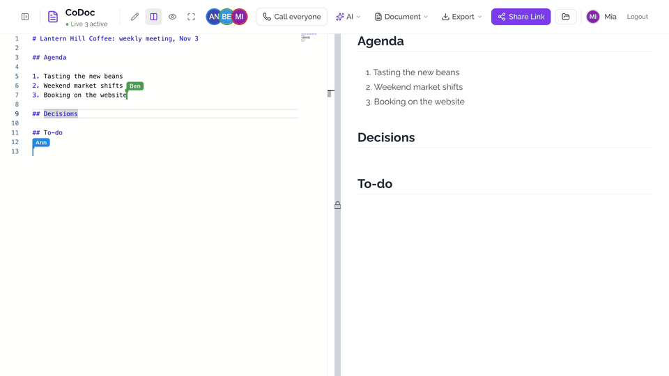

<!-- Film: once CoDoc-in-MD-tour.en.mp4 and the zh-TW version are uploaded, link them here. -->

## What it's good for

| When | How it helps |
|---|---|
| **Meetings** | Write the agenda first, take notes together, and put decisions and to-dos down as they happen. **Call everyone** who has the document open. Next week, **Duplicate** it and change the date. |
| **Classes and study groups** | The video and the PDF sit at the top of the page and the notes below them, with LaTeX math and code that has colors and line numbers. |
| **Design docs and specs** | A flowchart is a few lines of text: change a word and the diagram changes on everyone's screen. |
| **Conference and meetup notes** | A few people write. Everyone else opens Preview, full screen if they like, and the page grows by itself. |
| **Hackathons and community projects** | One link, no accounts: people are writing a minute after you send it. |
| **Documents that do things** | A table that follows a workbook, an Excel UserForm people fill in right there, and an AI that asks before it writes. |

If you've used HackMD, you'll recognize the syntax. See [what isn't there yet](#not-there-yet) before you move a team's
documents in: there are no permissions or version history, so it suits everyday team notes, not private ones.

## Write together

- **The link is the invitation.** **Share Link** copies the address. Whoever can reach the app opens it and is in, with no
  account. Signed in through [Relack](https://github.com/milochen0418/relack) you show under your own name; otherwise as
  Guest.
- **See who's where.** Everyone's caret and selection show in their own color, with a name tag while they type or move.
  The avatars in the header are ringed in the same color, and no two people on a document share one.
- **Nobody overwrites anybody.** Editing goes through [Yjs](https://yjs.dev/): two people can work on the same line at
  once, both keep their words, and everyone ends up with the same text.
- **Four ways to look at it.** **Split** (editor and preview, with a lock on the divider that scrolls them together),
  **Editor**, **Preview** and **Fullscreen** (Esc leaves it). Others' edits arrive in all of them, so people who only read
  never refresh.
- **Find and reuse.** The Document Manager searches titles, text, ids and creators, and filters by who made a document and
  when. **Duplicate** copies a document, which is all a meeting template needs.
- **Take it with you.** **Export** gives the Markdown, or a PDF of the text, tables and code.
- **Link previews.** A document's link carries its title and first lines, for chat apps that read Open Graph, such as Relack.

## Put anything in a document

One line of text, and it's there for everyone:

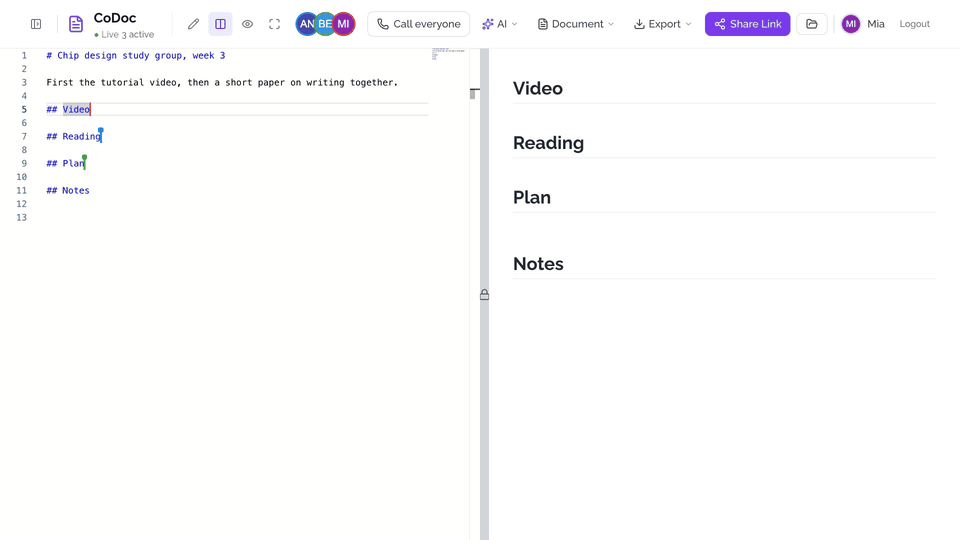

| What | Write this | Good to know |
|---|---|---|
| YouTube | `` | An id or a link. It plays in the document. |
| Vimeo | `` | An id or a link. |
| PDF | `` | `https` only, up to 15 MB. It comes through the app's server, so sites that refuse to be framed still work. |
| GitHub Gist | `` | |
| SlideShare | `` | |
| Speaker Deck | `` | |
| Picture | `` | From a link; the size is optional. |
| ReflexGrid form | `` | A real Excel UserForm: see [below](#reflexgrid-in-a-document). |
| ReflexGrid cells | `` | Read only, and they follow the workbook. |

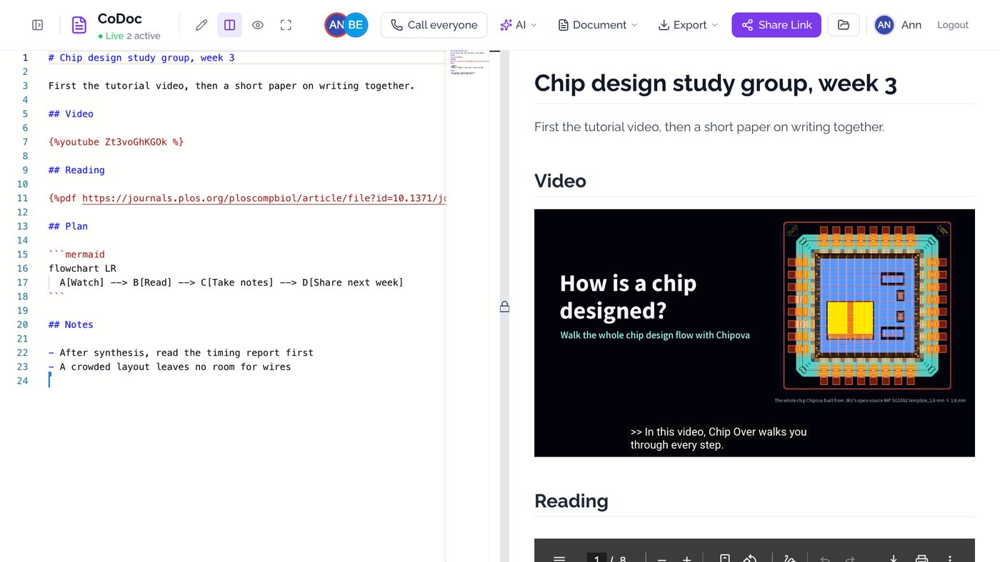

Keep the video or PDF above the notes: it keeps playing while people write below it. A new paragraph *above* it can make
it load again, and a video then goes back to the start. (ReflexGrid forms and cells don't have this problem.)

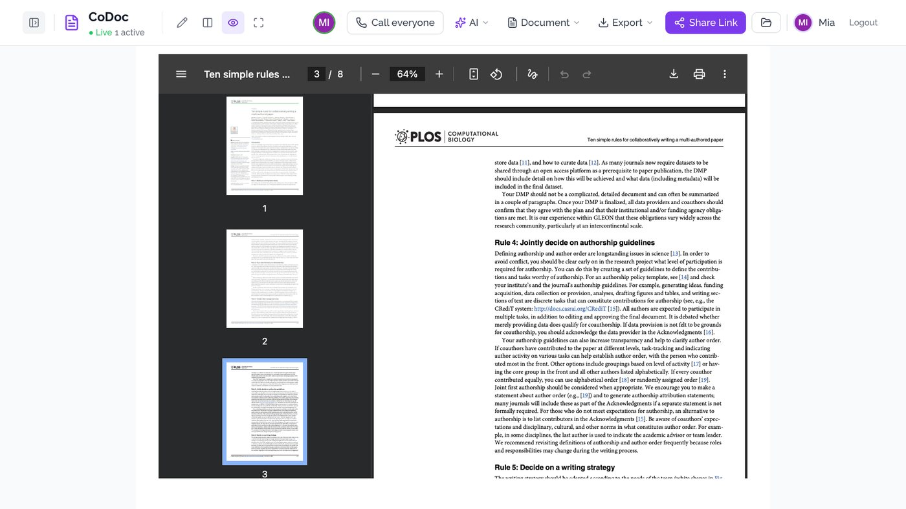

## Diagrams that follow the text

A fenced block becomes a picture. Change the text and it changes for everyone.

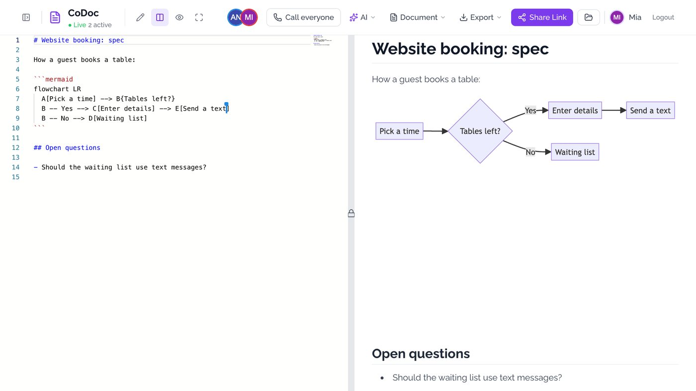

| Block | What it draws |
|---|---|
| ` ```mermaid ` | Flowcharts, sequence diagrams, Gantt charts and the rest of [Mermaid](https://mermaid.js.org/) |
| ` ```plantuml ` | [PlantUML](https://plantuml.com/). The text goes to plantuml.com unless `CODOC_PLANTUML_SERVER` names your own server. |
| ` ```graphviz ` or ` ```dot ` | [Graphviz](https://graphviz.org/) |
| ` ```sequence ` | [js-sequence-diagrams](https://bramp.github.io/js-sequence-diagrams/) |
| ` ```flow ` | [flowchart.js](https://flowchart.js.org/) |
| ` ```vega ` | Charts from a [Vega-Lite](https://vega.github.io/vega-lite/) spec |
| ` ```abc ` | Sheet music in [ABC notation](https://abcnotation.com/) |
| ` ```csvpreview ` | CSV as a table |

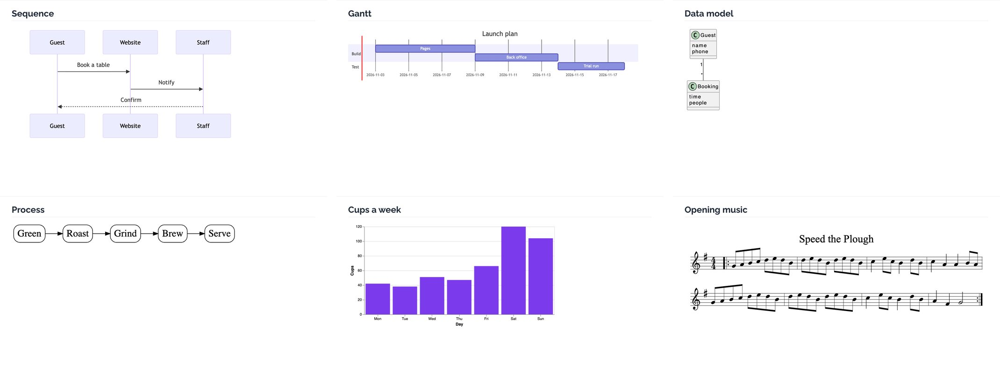

## Math, code and the rest of Markdown

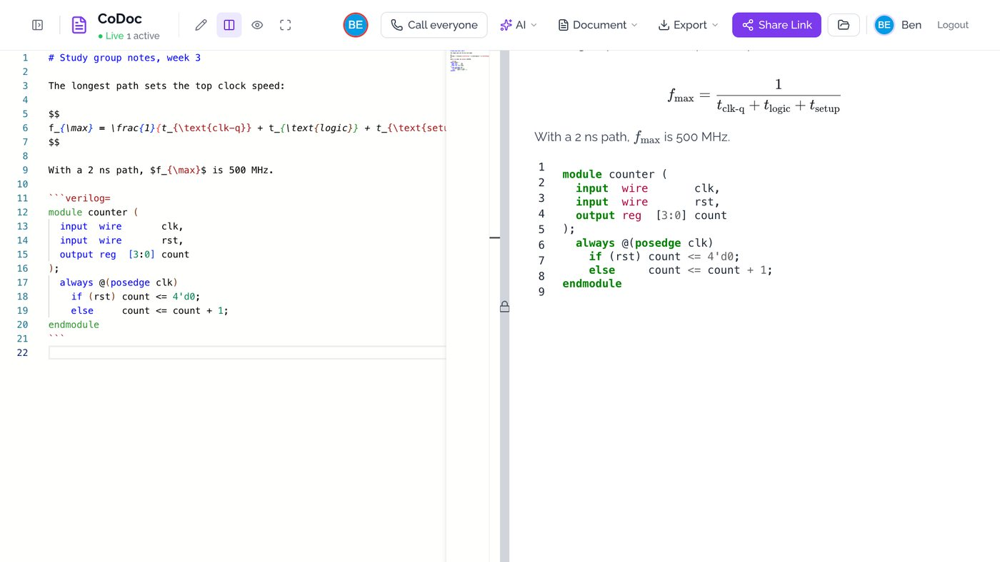

- **Math**: LaTeX, inline with `$E=mc^2$`, on its own line with `$$ ... $$`.
- **Code**: highlighted on the server with Pygments, so it stays stable. Add `=` for line numbers (` ```python= `), `=101` to
  start at 101, `=+` to carry on from the block before, `!` to wrap long lines.
- **Callouts**: `:::info`, `:::success`, `:::warning`, `:::danger`, and `:::spoiler Title` for a folded section.
- **Tables** (with alignment), **task lists**, **footnotes**, **abbreviations** (`*[HTML]: Hyper Text Markup Language`),
  **ruby** (`{ruby 漢字|かんじ}`), and `[TOC]` for a table of contents in Split view.
- **Small things**: `^sup^`, `~sub~`, `++underline++`, `==highlight==`, emoji (`:tada:`), Font Awesome icons, and who said
  it on a quote (`[name=Mia] [time=...] [color=#907bf7]`).

## Call everyone

**Call everyone** in the header rings the people who have the document open: each gets Accept or Decline for 45 seconds.
While the call is on, everyone on the document, including people who open it later, sees **Join call · N**. The call
needs a call app on re_ddns, see [Calls](#calls).

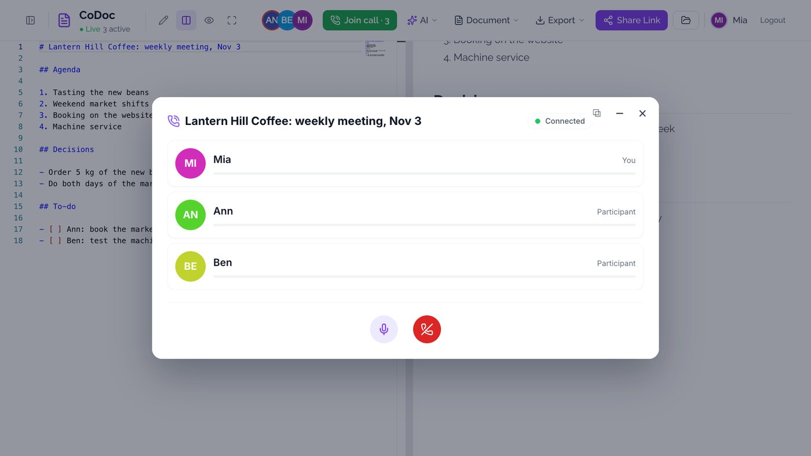

## AI

On re_ddns with the [AI Hub](https://github.com/milochen0418/ai_hub) installed, the header has an **AI** menu. The app
holds no model, key or address of its own: the hub chooses the models, and without a hub the menu isn't there.

- **Assistant** (Alt+A) opens the hub's assistant on this document. It reads what you select, answers from the document,
  and writes in it: every change waits for your **Accept** in the chat.
- **Rewrite** (Cmd/Ctrl+I, or the **✦ AI** button on a selection) works on the selection: your own words, or Improve, Fix
  mistakes, Shorter, Longer, To English, To 繁體中文, Sum up, To a table. With nothing selected it writes at the caret.
  You see the answer before anything changes; **Replace** or **Insert below** puts it in as your own edit, so Ctrl+Z
  takes it back. Which model answers is set on the hub's page, on this app's line (the role `fast`).
- **Talk** calls up the hub's talking AI. It can read the document; changing it takes the assistant.

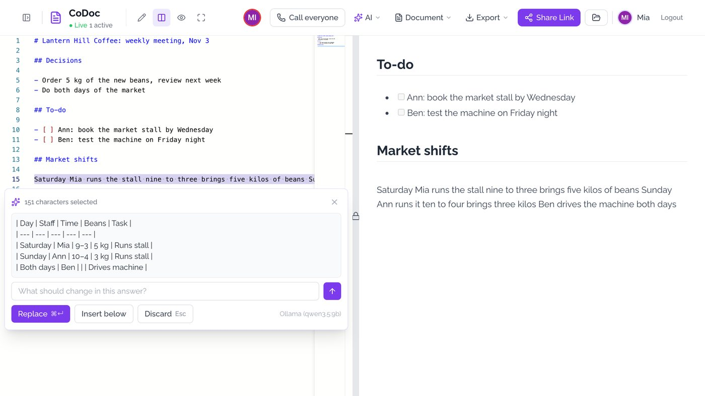

The assistant works like one more person on the document: it shows among the people there, what it wrote stays marked
in its color for a moment, and its change merges with what the others type at that moment. Ctrl+Z doesn't reach it (to
the editor it is someone else's edit), so a note at the bottom left, for everyone on the document, takes it back with
**Undo** for 30 minutes, unless people wrote over that text since.

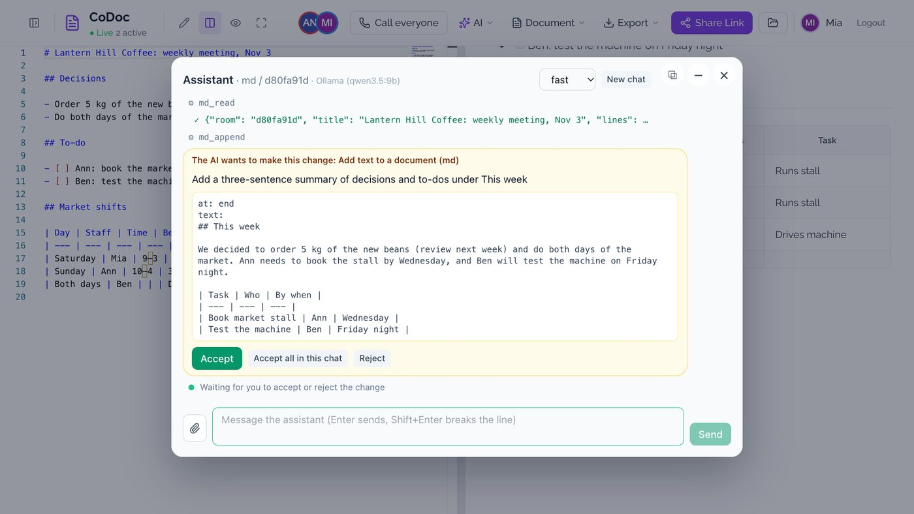

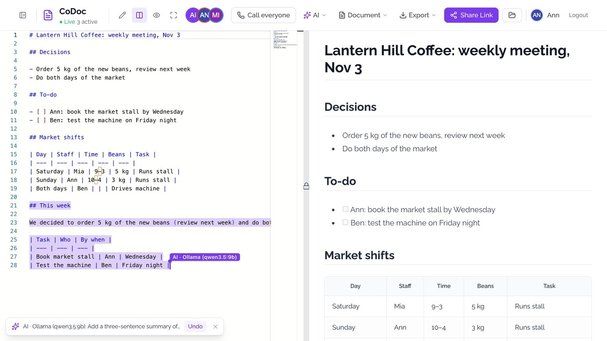

`codoc_in_md/ai_tools.py` holds the tools the hub offers its AI (`md.read`, `md.edit`, `md.append`, `md.rewrite`, `md.create`,
`md.list_documents`) and `md.guide`, which tells the AI this editor's Markdown. `/yjs` stays a plain relay, and the text
stays in the browsers: to make a change the server joins the room for a moment (`yjs_ws.Visitor`), gets the text from the
tabs and sends its change to them. With no tab open the change goes straight into the saved document.

Settings, for local development (on re-ddns there is nothing to configure):

- `DDNS_AI_HUB_URL`: where the hub's backend is, with the same `DDNS_AUTH_SECRET`. The menu needs this or `RE_DDNS_API_URL`.
- `DDNS_INTENT_URL_AI`: where its pages are, and `DDNS_INTENT_PROVIDER_AI_ASSIST=ai`, `DDNS_INTENT_PROVIDER_AI_TALK=ai`: the
  app that provides the assistant and the talking AI, when there is no registry.

E2E suite (a stand-in for the hub runs inside it):

```bash
DDNS_AI_HUB_URL=http://127.0.0.1:8397 DDNS_INTENT_URL_AI=http://127.0.0.1:8397 DDNS_INTENT_PROVIDER_AI_ASSIST=ai \
DDNS_INTENT_PROVIDER_AI_TALK=ai DDNS_INTENT_TRUST_LOCALHOST=1 DDNS_AUTH_SECRET=<32 characters or more> \
poetry run ./run_test_suite.sh ai_assist
```

## ReflexGrid in a document

[ReflexGrid](https://github.com/milochen0418/reflex_grid) workbooks can show in a document: a UserForm people use
right there, and cells that follow the workbook live, so a row added on the form shows in the table at once.

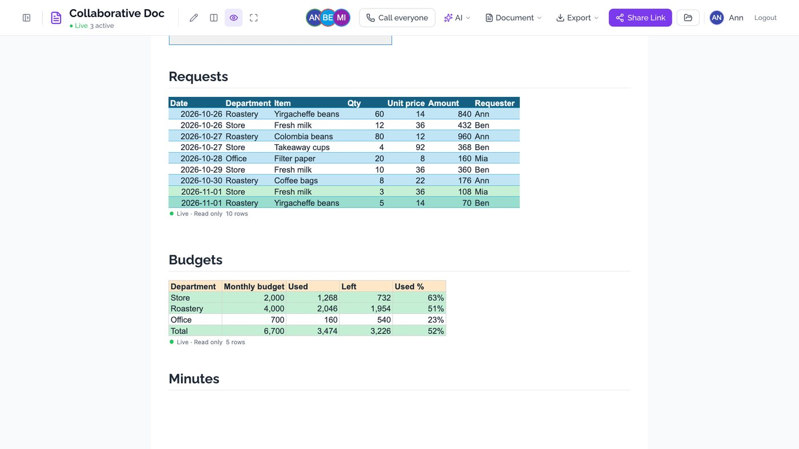

```
        the UserForm, working
          an Excel table: it grows with the table
     down to wherever the data in columns A to D ends
   these cells and no others
```

**Document › Insert from Excel** opens ReflexGrid's own dialog (the intent `grid.pick`): choose a workbook, then
a form, a table or cells, and the line goes in at the caret. On the workbook, **Insert › Embed** gives the same
lines to copy. Cells are read only in the document; a UserForm is the only way to change anything from there.

Only an empty box goes in the document. `assets/embed_frames.js` keeps each frame in a layer of its own over its
box, because React moves a box when a block is added above it, and an iframe that moves reloads: a form someone
is filling in survives the others typing. Switching view mode replaces the preview, frames included, so what was
typed on a form and not sent yet is lost then. Printing and **Export as PDF** show the box's label, not the frame.

Settings, for local development (on re-ddns there is nothing to configure):

- `DDNS_INTENT_URL_GRID`: where ReflexGrid's pages are (e.g. `http://127.0.0.1:3320`).
- `GRID_BACKEND_URL`: where its backend is (e.g. `http://127.0.0.1:8320`), when that isn't the same address.
- `DDNS_INTENT_PROVIDER_GRID_PICK=grid`: the app that provides `grid.pick`, when there is no registry.

E2E suite (a stand-in for ReflexGrid runs inside it): `DDNS_INTENT_URL_GRID=http://127.0.0.1:8398 poetry run ./run_test_suite.sh grid_embed`

## Where documents are saved

- **Run on its own** (e.g. `poetry run ./reflex_rerun.sh`): in the app's SQLite database (`db_url` in
  `rxconfig.py`), saved as you type.
- **Installed from the re_ddns App Store** (dev or normal install): each document is a Markdown file in the
  shared collection `documents` instead, `documents/by-app/md/<doc id>/doc.md` under the host's collections
  folder (`/Users/Shared/re-ddns/collections` by default). Editing together works as before (it goes through
  the Yjs relay); a change is written to the file 1.5 s after it is made, and whatever is unwritten when the
  app stops is written then. Documents therefore survive reinstalling the app, the App Store's **Storage**
  page lists them, and other apps given the collection can read them.

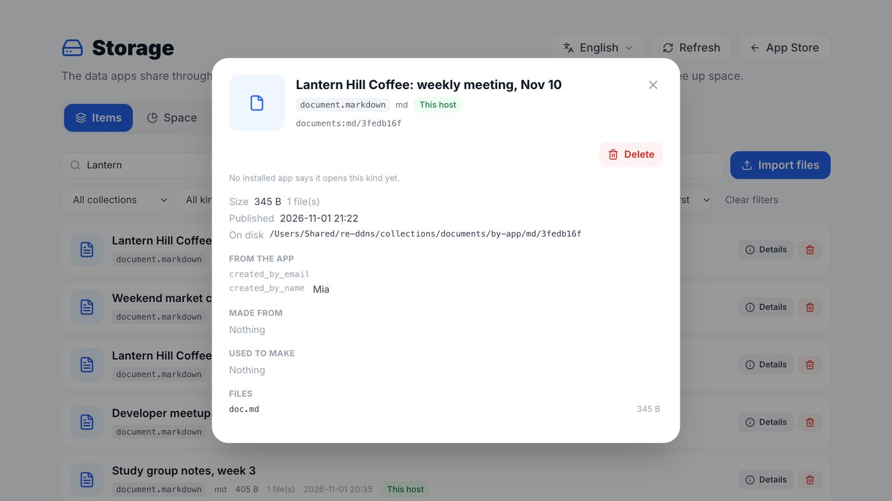

Which one is used follows `DDNS_COLLECTIONS_ROOT`, which re_ddns sets for apps that declare storage. A unit
test covers the collection store: `poetry run pytest tests`.

## Not there yet

- **Permissions.** There are none: anyone who can reach the app can read, change or delete any document, and the list
  shows everyone's. Signing in only gives you a name. Keep it on a network you trust, and keep private things out.
- **History.** No version history, comments or trash. The list's delete buttons (the one on each row, and Clear All) don't
  ask first, and a deleted document is gone. Only the AI's changes can be taken back, for 30 minutes.
- **Uploads.** Pictures and PDFs come from a link; there is nothing to upload them with.
- **Slides, books, tags, templates, GitHub sync, dark mode, offline editing.**
- **Phones.** There's a phone menu, but nobody has tested writing on a phone. On re_ddns each device also needs the
  host's DNS setting and certificate, so colleagues have to be able to reach your machine.
- **PDF export** keeps text, tables and code. Math stays as its source; diagrams and embeds don't come along.
- **Public services.** The diagram blocks load their drawing libraries from public CDNs, and PlantUML text goes to
  plantuml.com by default.
- **Small things.** A line of only `---` shows as a dash: use `***` or `___` for a rule. `[TOC]` is empty in Preview Only.
  Lists inside `:::` callouts come out as plain text. While a code block is still open, the preview can show bits of markup
  until the closing fence is typed. When typing English, word suggestions can pop up, and Enter then takes the suggestion
  instead of starting a line: press Esc first.

## Getting Started

This project uses [Poetry](https://python-poetry.org/) for dependency management.
Make sure you have **Python 3.11** (`pyproject.toml` allows 3.11 – 3.15) and Poetry installed.

### 1) Clone

```bash
git clone <repository-url>
cd codoc_in_md
```

### 2) (Recommended) Ensure Poetry uses Python 3.11

Poetry may auto-select a different Python version (e.g. 3.12+). This project targets **3.11**.

```bash
poetry env use python3.11
poetry env info
```

If `python3.11` is not on your PATH, specify the full executable path:

```bash
poetry env use /absolute/path/to/python3.11
```

### 3) Install dependencies

```bash
poetry install
```

### 3.1) macOS system dependencies (PDF export)

PDF export uses WeasyPrint, which requires native libraries on macOS.

```bash
brew install cairo pango gdk-pixbuf libffi
```

### 4) Run the app

```bash
poetry run reflex run
```

Then open:

- Frontend: http://localhost:3000
- Backend: http://localhost:8000

`/` is the Document Manager: **New Document** starts one, and its address (`/doc/<id>`) is what you share.

## E2E Tests (Playwright)

E2E suites live under `testcases/<suite_name>/run_test.py`.

Run suites via the repo runner (it starts/stops the Reflex server and collects artifacts):

```bash
poetry run ./run_test_suite.sh smoke_home
```

### Useful environment variables

- `BASE_URL` (default `http://127.0.0.1:3000`)
- `HEADLESS=0` to show the Chromium window (recommended while developing/debugging tests)
- `PW_SLOWMO_MS=100` to slow actions down so you can watch what happens (only applies when supported by the test)
- `PW_TIMEOUT_MS=60000` to increase Playwright timeouts on slower machines

### Example: run a suite with visible Chromium

This is helpful when debugging interaction-heavy suites (e.g. split view drag/scroll tests):

```bash
HEADLESS=0 PW_SLOWMO_MS=100 poetry run ./run_test_suite.sh split_view_operate
```

Artifacts (screenshots/logs) are written to `testcases/<suite_name>/output/`.

## Calls

The call runs in a separate call app, opened in a dialog through the DDNS Intent `call.join`
([reflex_ddns_auth](https://github.com/milochen0418/reflex_ddns_auth)), e.g. the self-hosted
[LiveKit audio chat](https://github.com/milochen0418/reflex_ddns_livekit_audio_chat). On re-ddns the
app that provides `call.join` is found through the intent registry; nothing to configure.

If several apps provide `call.join` (e.g. audio, video and avatar chat), whoever starts the call
chooses one. The call keeps that choice: everyone who accepts or joins later goes straight into the
same app, without being asked, because calls in different apps can't reach each other. The next
call is chosen afresh.

Other dialogs (e.g. a Relack profile), the **–** button or a click outside minimize the call to a
tray at the bottom left; it keeps running. Hang up, or close it from the tray, to leave.

Settings (all optional):

- `DDNS_INTENT_PROVIDER_CALL_JOIN`: the app(s) that handle `call.join` when there is no registry,
  comma-separated, e.g. `livekit` for local development.
- `DDNS_INTENT_URL_LIVEKIT`: where that app runs, for local development (e.g. `http://localhost:3200`).
- `CODOC_CALL_APP`: always use this app, skipping the registry.

E2E suite (the call app must be running at `DDNS_INTENT_URL_LIVEKIT`):

```bash
DDNS_INTENT_PROVIDER_CALL_JOIN=livekit DDNS_INTENT_URL_LIVEKIT=http://localhost:3200 \
poetry run ./run_test_suite.sh doc_call
```

Choosing among several call apps: the same call app also stands in as a second one, `livekit-alt`,
reached at `127.0.0.1` (another origin):

```bash
DDNS_INTENT_PROVIDER_CALL_JOIN=livekit,livekit-alt DDNS_INTENT_URL_LIVEKIT=http://localhost:3200 \
DDNS_INTENT_URL_LIVEKIT_ALT=http://127.0.0.1:3200 poetry run ./run_test_suite.sh doc_call_app_choice
```

## Tech Stack

- **Reflex**: Full-stack Python web framework
- **reflex-monaco**: Monaco Editor integration
- **Yjs**: Editing together, relayed by the app's server
- **Pygments**: Server-side syntax highlighting (used for HackMD-style code fences)
- **pycrdt**: The server's copy of a document's Yjs text for a moment, when the AI changes it
- **Python 3.11**
